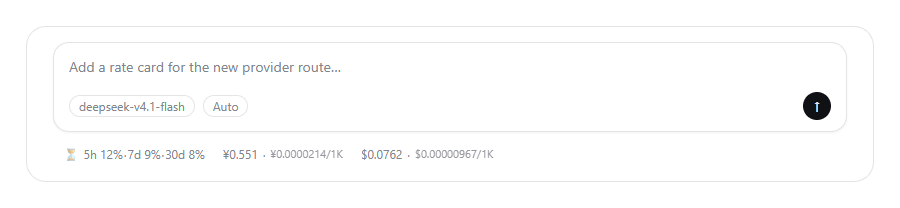
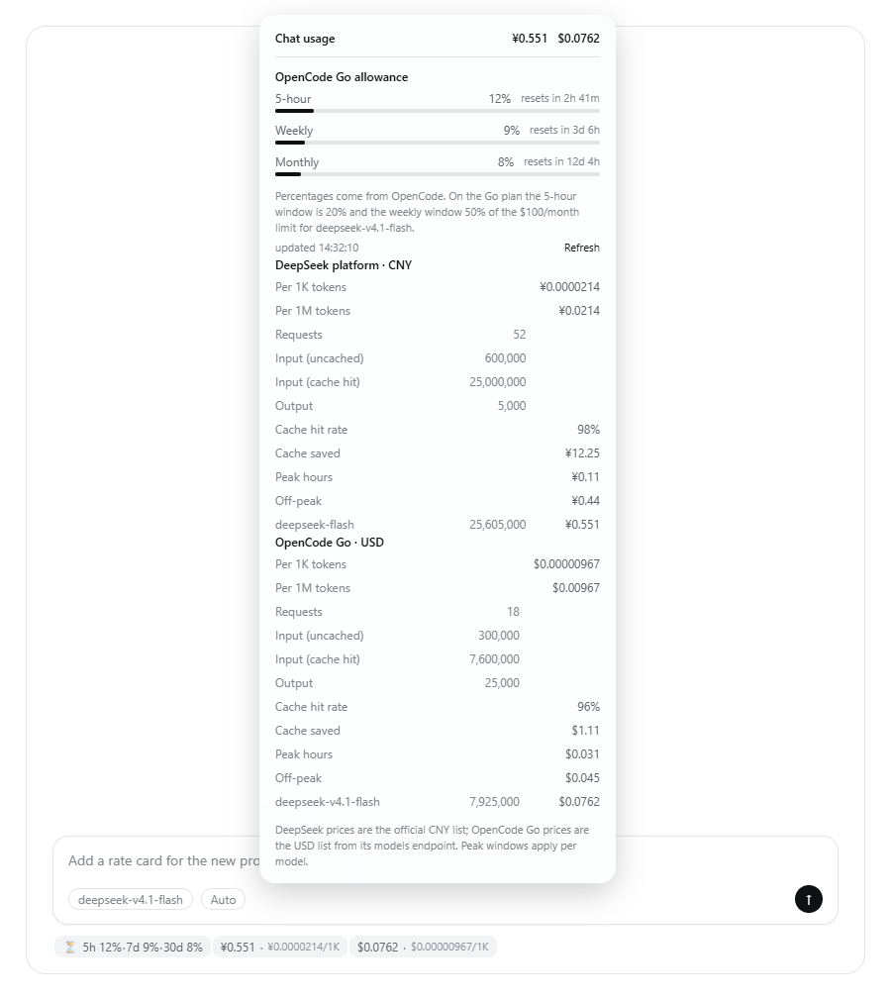

# deepseek-harness-cost


A **chat cost meter for [DeepSeek Harness](https://github.com/deepseek-ai/deepseek-harness)**.
One pill under the composer answers three questions in the currency the chat
actually spends:

1. **What has this chat cost?** — `¥0.551` on the DeepSeek platform, `$0.0762`
   on OpenCode Go.
2. **What is it costing per 1K tokens?** — the realized blended rate, e.g.
   `¥0.0000214/1K` or `$0.00000967/1K`.
3. **How much of the subscription allowance is left?** — OpenCode Go only, with
   the 5-hour, weekly and monthly windows and their reset countdowns.

A chat that used both providers shows both currencies side by side instead of
converting one into the other. A chat on a provider with no price card shows no
money and reports the excluded requests in the panel.



<sub>Sample values. The pill reads, left to right: allowance windows, then one
cost reading per currency the chat used.</sub>

## Install with your AI

Copy the prompt below into Claude, Codex, Cursor, or any agent that can run
commands on this machine. It installs the plugin into the DeepSeek Harness
profile the agent finds running, then checks that it loaded.

```text
Install the DeepSeek Harness plugin "deepseek-harness-cost" into the DSH profile that
is running on this machine, then verify it.

1. Find the running DeepSeek Harness profile: Desktop keeps profiles under
   ~/.dsh/profiles/ (use the one the running app uses), and a CLI install reports it
   with `dsh plugin --profile <profile> ...`. Do not create or switch profiles.
2. Install through the supported path, in this order:
   a. GUI: Plugins -> Add plugin -> deepseek-harness-cost
   b. CLI: dsh plugin --profile <profile> add deepseek-harness-cost
   c. If the dsh command is not available (Desktop app), install inside the profile
      directory with pnpm: `pnpm add deepseek-harness-cost`, then add
      "deepseek-harness-cost" to dsh.profile.bundles in that profile's package.json.
3. Do not edit the plugin's files, do not touch other plugins, and do not modify any
   Session data.
4. Verify: the Plugins page lists deepseek-harness-cost with a "chat-cost" row, and
   after reloading the page a cost pill appears under the chat composer showing the
   chat cost and rate per 1K tokens.
5. If this machine uses OpenCode Go, check that an OPENCODE_GO_API_KEY credential
   exists in the Harness credential store. Without it the cost still shows; the
   allowance section reports a missing key.
Report what you changed and which version is installed. If any step is not possible
on this machine, stop and say which step and why instead of working around it by hand.
```

Prefer to do it yourself? The two commands are in [Install](#install) below.

## Why this one

- **Provider-reported, not estimated.** The numbers are the usage the provider
  already returned and the Session log already stored — not a local token guess.
- **Two currencies, never mixed.** CNY and USD are separate sums. There is no
  exchange-rate guess anywhere.
- **Subscription-aware.** OpenCode Go is metered as a subscription: the pill
  shows the 5-hour, weekly and monthly allowance windows, not just a dollar
  figure.
- **Whole conversation, not one log.** Subagent and workflow children are
  separate Sessions; the meter walks the Session tree and sums every descendant.
- **Zero token overhead.** It reads the Session log and two account/price
  endpoints. It never adds a prompt section, a tool, or a model request, so it
  cannot inflate the number it displays.
- **No dependencies, no build step.** Plain ESM; the browser half borrows React
  from the Host module table.

## What you see

Click the pill for the full reading: requests, uncached/cached/cache-write input
and output tokens, the cache-hit rate, the peak/off-peak split, a per-model
breakdown, and the allowance detail.



<sub>Sample values. The allowance section only appears for a chat that used
OpenCode Go; the currency sections appear for every provider the chat billed.</sub>

## Install

DeepSeek Harness Desktop or Web, with the plugin manager available.

**From the GUI:** open **Plugins**, choose **Add plugin**, and enter:

```
deepseek-harness-cost
```

**From a terminal** (CLI installations):

```
dsh plugin --profile <profile> add deepseek-harness-cost
```

Pin an exact version when you want reproducible installs:

```
dsh plugin --profile <profile> add deepseek-harness-cost@1.4.0
```

The bundle is selected when it installs and the pill appears under the composer
immediately (the browser half also hot-reloads into an open page).

## Update

When a newer version is published, the **Plugins** page shows it next to the
plugin and offers **Update** — one click replaces the installed version in
place. Nothing to run in a terminal.

Updates are only offered for plugins installed from a registry. If you installed
a pinned `git+…` spec instead, reinstall it with the new tag or commit.

## Requirements

- A DeepSeek Harness profile with the plugin manager (the Desktop or Web
  application profile).
- For the **allowance** half only: an `OPENCODE_GO_API_KEY` credential in the
  Harness credential store — the same key the OpenCode provider uses.
- The **cost** half needs nothing: it prices the Session log against published
  list prices.

Without the OpenCode key the plugin still shows CNY cost and rate; the allowance
rows simply report that the key is missing.

## How the numbers are made

**Usage.** Every settled model attempt in the Session log carries
`inputTokens`, `cacheReadTokens`, `cacheWriteTokens` and `outputTokens`. The Host
half folds those with the same replacement rule the Harness itself uses:

- `assistant/message` carries the settled attempt's usage; `assistant/attempt`
  may carry a streaming sample; a later sample for the same `(turn, step)`
  **replaces** the earlier one instead of adding to it.
- `llm/retry-started` closes the replacement slot, so a retried attempt is
  billed again (it was a second provider request).
- `request/context` names the provider route a request went to; the assistant
  message's own `source.model` / `source.provider` win when present.

**Currency.** The provider route decides the card:

| Route | Card | Pill |
|---|---|---|
| `deepseek-official`, `deepseek-account` | DeepSeek CNY list prices | `¥total · ¥rate/1K` |
| `opencode-go` | OpenCode Go USD list prices (live from its models API) | `$total · $rate/1K` + allowance |
| anything else | none | no money; the panel reports excluded requests |

### Price cards

| Card | Cache-miss input | Cache read | Output | Peak |
|---|---|---|---|---|
| DeepSeek CNY (per 1M) | ¥1 (`deepseek-flash`) | ¥0.02 | ¥4 | Mon–Fri 09:00–12:00, 14:00–18:00 Beijing, ×2 |
| OpenCode Go USD (per 1M) | $0.15 (`deepseek-v4.1-flash`) | $0.003 | $0.60 | Mon–Fri 01:00–04:00, 06:00–10:00 UTC, ×2 |

The CNY card is static and configurable. The USD card is **fetched from
`GET https://opencode.ai/zen/go/v1/models`** at startup and refreshed hourly, so
a price change does not need a plugin release; the built-in table is only the
offline fallback. Peak windows, peak factor and cache prices all come from that
reply.

### The per-1K figure

`¥0.0000214/1K` is one number: everything the Session paid in that currency,
divided by every token the provider reported in that currency.

```
per 1K = total cost ÷ (cache-miss + cache-read + cache-write + output) × 1000
```

The numerator already contains every rate, so the result is the realized average
price per token, not a tariff lookup. The panel also shows **per 1M tokens**,
directly comparable with the cards above, and **cache saved**, which explains why
a cache-heavy chat runs far below list price.

### The allowance windows

OpenCode Go is a subscription: a 5-hour rolling window (20% of the monthly
limit), a weekly window (50%) and the monthly limit (100%). The Host reads
`GET https://opencode.ai/zen/go/v1/usage` with the same `OPENCODE_GO_API_KEY` the
provider uses, caches the reply for 30 seconds, and exposes it on the plugin's
own Host route. The pill shows the **used** percentage of each window; the panel
adds the reset countdown.

The percentages are authoritative and come straight from OpenCode. The panel
names the plan and the model's published monthly limit, but it does not turn a
rounded percentage into a dollar amount that would pretend to more precision than
the endpoint reports.

## Configure

Every option has a working default. To override a rate, a route or the plan, put
a `config` block on the plugin row in the profile's `cordis.patch.yml` (the same
row the bundle inserts):

```yaml
- id: chat-cost
  name: deepseek-harness-cost
  config:
    routes:
      deepseek-official: CNY
      deepseek-account: CNY
      opencode-go: USD
    models:
      deepseek-flash: { cacheHit: 0.02, cacheMiss: 1, cacheWrite: 0, output: 4 }
      deepseek-v4-pro: { cacheHit: 0.15, cacheMiss: 4.5, cacheWrite: 0, output: 13.5 }
    defaultModel: deepseek-flash
    offPeakRatio: 0.5
    peakMode: auto          # auto | peak | off-peak
    peak:
      timezoneOffsetMinutes: 480
      days: [1, 2, 3, 4, 5]
      windows: [[9, 12], [14, 18]]
      holidays: []
    usd:
      apiKeyRef: OPENCODE_GO_API_KEY
      baseUrl: https://opencode.ai
      modelsPath: /zen/go/v1/models
      usagePaths: [/zen/go/v1/usage, /inference/go/v1/usage]
      plan: go              # go | go-plus | go-teams
      quotaTtlSeconds: 30
      modelsTtlSeconds: 3600
      requestTimeoutMs: 10000
      monthlyLimitUsd: null
```

| Field | Default | Meaning |
|---|---|---|
| `routes` | the three rows above | provider id → `CNY` / `USD`; a route absent here is not priced and is reported as excluded (set a route to `null` to drop a default). |
| `models` | the two CNY tables | CNY per 1M tokens at peak, per model id. A model without a row is priced with `defaultModel` and marked `≈`. |
| `defaultModel` | `deepseek-flash` | CNY rates for an unpriced DeepSeek model id. |
| `offPeakRatio` | `0.5` | CNY off-peak multiplier. |
| `peakMode` | `auto` | `auto` computes the CNY peak from the clock; `peak` / `off-peak` force one rate. |
| `peak.*` | Beijing, Mon–Fri | the CNY peak clock and statutory holidays. |
| `usd.apiKeyRef` | `OPENCODE_GO_API_KEY` | credential reference the allowance and models calls use. |
| `usd.baseUrl` | `https://opencode.ai` | allowance API origin. |
| `usd.modelsPath` / `usd.usagePaths` | the published endpoints | origin-relative paths; anything that is not a plain path (`//host`, `@host`) is ignored. |
| `usd.plan` | `go` | names the plan and its per-model monthly limit in the allowance panel; the percentages do not depend on it. |
| `usd.monthlyLimitUsd` | `null` | overrides the per-model monthly limit. |
| `usd.quotaTtlSeconds` / `usd.modelsTtlSeconds` | `30` / `3600` | how long the allowance and price replies are cached. |

## Privacy and network access

- Session logs never leave the machine. The meter runs inside the Host process.
- The only network calls are two `GET`s to the configured OpenCode origin: the
  price sheet (`/zen/go/v1/models`) and the account allowance
  (`/zen/go/v1/usage`). Both carry the `OPENCODE_GO_API_KEY` credential, over
  HTTPS, and nothing else.
- The credential is resolved on the Host per call and is never stored in the
  projection, logged, put in a URL, or sent to the browser.
- The browser half only talks to the plugin's own Host route, which sits behind
  the Harness Connection fence: Host/Origin checks plus browser authentication.
- No telemetry, no analytics, no remote config.

## Compatibility

Built and verified against DeepSeek Harness `0.2.2-rc.5`. It uses the public
Host services (`credentials`, `sessionProjections`, `webServer`, `connection`)
and the client slot API; it does not patch or monkey-patch the Harness.

## Development

The package is plain ESM with no dependencies: no build step, no `node_modules`.

```
node --check index.js
node --check client.js
node test/fold.test.mjs
node test/real-log.mjs "<session store>/<workspace>/<session>/session.v4.jsonl.zstd"
node test/audit.mjs --all
```

`fold.test.mjs` covers the CNY and USD price arithmetic, both peak clocks, the
replace-don't-double-count rule for streamed usage, route grouping across
providers, the per-1K identity, the allowance normalization and plan-limit
mapping, the models-endpoint parser, the client formatters, and the subagent
combination.

`real-log.mjs` folds a real Session log twice — once through the plugin's unit,
once through an independent reduction — and fails if any bucket or currency
total disagrees.

`audit.mjs` shares no code with the plugin (its own zstd reader, fold, route
resolution, peak clocks and transcribed price tables), re-prices every Session
log on the machine, and fails on any difference.

Files: `index.js` (Host unit: fold, pricing, allowance route), `client.js`
(browser pills and panel), `cordis.patch.yml` (the loader row), `locale/*.json`
(plugin-manager copy).

## Troubleshooting

- **No pill under the chat** — the bundle is installed but not enabled: check
  **Plugins** in the sidebar.
- **Allowance shows “key missing”** — add the `OPENCODE_GO_API_KEY` credential;
  the CNY half keeps working without it.
- **A provider shows no money** — its route has no price card. Add it under
  `routes` plus a `models` row, or read it as excluded in the panel.

## License

MIT © Jooyan Bagheri. Not affiliated with DeepSeek or OpenCode.
